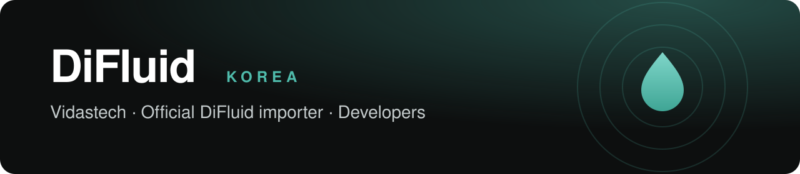

  <b>DiFluid 한국 공식 대리점</b> 비다스테크의 개발자 공간입니다. 
  The developer space of <b>Vidastech</b>, the official DiFluid distributor in Korea.

  <a href="https://www.difluid.kr"><b>공식몰 · Store</b> difluid.kr</a> &nbsp;·&nbsp;
  <a href="https://github.com/difluid-korea/difluid-ble-guide"><b>BLE 개발자 가이드 · Developer guide</b></a> &nbsp;·&nbsp;
  <a href="mailto:difluid.kr@gmail.com"><b>문의 · Contact</b> difluid.kr@gmail.com</a>

### 저장소 · Repositories

| 저장소 · Repository | 내용 · Contents |
|---|---|
| [**difluid-ble-guide**](https://github.com/difluid-korea/difluid-ble-guide) | DiFluid R2 Extract·Microbalance·Microbalance Ti 를 블루투스(BLE)로 붙이는 개발자 가이드. 실제 기기로 확인한 프로토콜, R2 원시 캡처, Python 예제 · BLE integration guide for the R2 Extract, Microbalance and Microbalance Ti — protocol verified on real devices, raw R2 captures, Python examples ([한국어](https://github.com/difluid-korea/difluid-ble-guide#readme) · [English](https://github.com/difluid-korea/difluid-ble-guide/blob/main/README.en.md)) |

### 피드백 · Feedback

DiFluid 기기로 개발하셨다면 알려 주세요. 사용 사례, 오류·버그, 기능 제안을 [difluid.kr@gmail.com](mailto:difluid.kr@gmail.com) 으로 받습니다. 직접 연동한 자료를 보내 주시면 검토해 작업자 이름과 함께 싣습니다.

Built something with a DiFluid device? Tell us. We take use cases, bug reports and feature requests at [difluid.kr@gmail.com](mailto:difluid.kr@gmail.com). Send us your own integration notes and we will publish them with your name after review.

DiFluid 및 각 제품명은 해당 소유자의 상표입니다. · DiFluid and its product names are trademarks of their respective owner.
